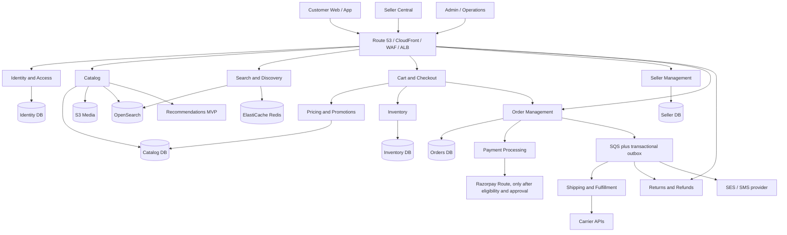

# Corner Store: Architecture and Workflows

This describes the marketplace that exists in this project today. It is a simple map of how the customer website, seller tools, administrator tools, server, and database work together.

## 1. Big-picture architecture

```text
 CUSTOMER BROWSER                 SELLER BROWSER                  ADMIN BROWSER
 Shop, search, cart, account      Seller studio                   Admin dashboard
          |                            |                                |
          +----------------------------+--------------------------------+
                                       |
                              HTTPS / JSON requests
                                       |
                         EXPRESS APPLICATION (src/server.js)
                  Login/session checks · validation · business rules
                    Customer APIs · seller APIs · admin APIs
                                       |
                    +------------------+------------------+
                    |                                     |
           STATIC WEBSITE FILES                    SQLITE DATABASE
           public/customer, seller, admin,   Users, sellers, products,
           css, and js                       stock, orders, shipments,
                                            payments, reviews, returns
```

The browser shows the pages and sends requests. Express checks who is signed in, validates the request, applies the marketplace rules, and reads or updates SQLite. The database is the source of truth for products, stock, users, and orders.

## 1.1 Production target: AWS microservices

The diagram above is the **current implementation**, not the requested production system. The code is currently a layered Express application with one SQLite database. Separate route/controller/service/repository files are useful boundaries, but they are **not independently deployable microservices**. There is no CDN/WAF, API gateway, distributed database, cache, search index, event bus, object store, carrier integration, or notification provider in the running application.

The requested direction is a set of independently deployable services. The following Mermaid diagram is the target; it must not be read as a claim that those AWS resources have already been provisioned:



### AWS service mapping

| Flowchart responsibility | Initial AWS mapping | Required ownership / rule |
|---|---|---|
| CDN, WAF, load balancer, API entry | Route 53, CloudFront, AWS WAF, Application Load Balancer; add API Gateway only if API management requirements justify it | TLS everywhere; private service tasks; no database exposed to the internet |
| Independently deployed application services | One ECS on Fargate service and task definition per deployable service | Separate health checks, IAM task role, scaling and deploy/rollback for each service |
| User and seller identity | Identity service, initially backed by its own PostgreSQL database | Identity owns credentials, sessions/tokens, role and store-scoped access grants; seller staff are not platform admins |
| Catalog, seller, orders, inventory, payments, returns | A database owned by each service, hosted on Amazon RDS for PostgreSQL initially | A service never reads or writes another service's tables; use APIs/events instead of cross-service joins |
| Cache and cart | ElastiCache for Redis | Cache is not the source of truth for inventory, payments, or placed orders |
| Search | Amazon OpenSearch Service | Search is a rebuildable projection of catalog data, updated from versioned events |
| Product images | Amazon S3 with private upload, validation, and controlled public delivery | Store image metadata in the catalog service; never store large media in relational rows |
| Event bus / queue | Amazon SQS queues, dead-letter queues, and an outbox in the producing service's database | Consumers must be idempotent; persist an event before asynchronous delivery |
| Email / SMS and shipping | SES and explicitly selected SMS/carrier providers | Provider credentials stay in Secrets Manager; webhook signatures and retry handling are required |
| Recommendations | Database-powered similar-product MVP; separate service only after measurable need | Recommendations must not block product browsing or checkout |
| Monitoring and secrets | CloudWatch logs/metrics/alarms and AWS Secrets Manager | Redact passwords, tokens, payment credentials, and sensitive customer information from logs |

These AWS services are a **design mapping**, not an instruction to create resources. Production resources can incur charges. Do not provision them until the account owner approves the AWS account, region, cost budget, domain, backup retention, and recovery objectives.

### Build sequence and completion gates

Every phase has to pass its tests and preserve existing marketplace behavior before the next phase changes the production data path. A box in the target diagram is complete only when its service, owned data, security boundaries, monitoring, failure behavior, and integration tests exist.

1. **Architecture and contract baseline (current step):** distinguish current code from target state, assign service/data ownership, and define migration order and acceptance gates.
2. **Production prerequisites:** choose the AWS region and monthly budget; prepare an AWS account, domain/DNS, environment/secret ownership, backup retention, restore objective, and payment-provider eligibility. No cloud infrastructure should be created with unknown cost approval.
3. **Data and runtime foundation:** migrate SQLite data safely to PostgreSQL; add schema migrations, per-service data ownership, idempotent migrations, automated backup/restore tests, container builds, private networking, secrets, health checks, logs and alarms. Keep the existing production data recoverable and do not cut over without a verified rollback.
4. **Identity and access service:** extract authentication from the monolith; implement customer, platform-admin, seller-owner, and store-scoped seller-staff identities, MFA and audit trail. Prove that staff cannot read or mutate another store's data.
5. **Catalog, seller, and media services:** extract category/product and seller onboarding domains; move uploaded assets to S3; enforce seller ownership on every read and write; publish catalog changes for the search projection.
6. **Search and discovery:** build and rebuild the OpenSearch index from catalog events, add cache safely, and keep the database as catalog source of truth.
7. **Pricing, cart, inventory, and checkout:** implement server-owned pricing, promotion rules, Redis-backed expiring carts, atomic inventory reservation/release, idempotency keys, and retry-safe checkout.
8. **Order management and asynchronous workflow:** give orders an owned database; use an outbox and SQS for versioned order events; implement idempotent shipment, cancellation, return, and notification consumers with dead-letter/replay procedures.
9. **Payment processing:** integrate a provider behind a payment service, with signed webhooks, reconciliation, idempotency, refund/reversal handling, and financial audit records. Razorpay Route documentation currently lists eligibility thresholds (domestic turnover above ₹40 lakh or qualifying export turnover above ₹5 lakh) and payer-payee transparency review; confirm the marketplace itself qualifies and is approved with Razorpay before building or enabling live seller transfers. A standard checkout key alone is not seller settlement approval.
10. **Shipping, returns, notifications, and recommendations:** integrate selected providers only after contracts and sandbox credentials exist; handle provider outages and webhook retries; keep the initial recommendation feature non-critical.
11. **Edge, operations, and launch gates:** add CloudFront/WAF/ALB policies, rate limits, restore and disaster-recovery drills, load/security tests, alert runbooks, staged deployment/rollback, privacy/data-retention controls, and legal/accounting review for India.

**Current completion:** the app still runs as one SQLite-backed Express application. Session persistence, production secret checks, health endpoints, and a manual verified backup utility exist. An un-deployed CDK foundation scaffold now defines the VPC, a migration-bridge PostgreSQL instance, private S3 media bucket, SQS queue/DLQ, ECS cluster, and ECR repositories; it creates no resources until someone explicitly deploys it. A read-only SQLite-to-PostgreSQL migration rehearsal is implemented and tested against an embedded PostgreSQL engine: it streams bounded batches in a consistent source snapshot, refuses non-empty targets, copies in one target transaction, checks row counts and per-table SHA-256 checksums, advances identity sequences, and rolls back on errors or data mismatches. It has not been run against a provisioned PostgreSQL server and does not connect the running app to PostgreSQL or split data into service-owned databases. Independent service applications, ECS task definitions, search/cache, public edge, real payment, seller staff accounts, and provider integrations do not exist yet. The next development phase is a PostgreSQL database adapter and repository test strategy; do not deploy the CDK foundation until a hard AWS spend cap and resource review are approved.

Razorpay Route requirements: [official Razorpay Route documentation](https://razorpay.com/docs/payments/route/). AWS mappings: [Amazon ECS on Fargate](https://docs.aws.amazon.com/AmazonECS/latest/developerguide/AWS_Fargate.html) and [Amazon RDS for PostgreSQL](https://docs.aws.amazon.com/AmazonRDS/latest/UserGuide/CHAP_PostgreSQL.html).

## 2. People and permissions

| Role | How they get access | What they can do |
|---|---|---|
| Customer | Create an account or sign in | Browse products, shop, place orders, view shipments, request eligible cancellations/returns, and leave delivered-purchase reviews |
| Seller | Create a normal customer account, apply on the Seller page, and wait for the store admin to approve | Manage their own products and stock; process, ship, add tracking, and confirm delivery for their own order items |
| Store admin | Sign in at the Admin page with the separately provisioned admin account | Approve or suspend sellers, manage the catalog and categories, oversee orders, configure commission/coupons, moderate reviews, and record manual payouts |
| App runner | Start the Node.js process on the computer/server hosting the site | Keep the website process running and configure its environment; this is not a website login or marketplace role |

**Important:** Sellers do not need the store administrator's password. The app runner may also be the store owner, but these are different responsibilities.

## 3. Main customer-to-delivery pipeline

```text
Customer browses products
        |
Adds items to bag (bag is stored in that browser)
        |
Signs in and submits checkout
        |
Server checks product availability, price, quantity, and stock
        |
Server creates one order and reserves stock
        |
One seller shipment is created for each seller in the order
        |
Each seller handles only their own shipment:
  Placed -> Processing -> Shipped (courier + tracking) -> Delivered
        |
Customer sees each shipment in account order history
        |
Overall order becomes Delivered after every seller shipment is Delivered
```

If a customer buys from two sellers, the checkout is still one customer order, but it has two seller shipments. Those sellers may ship separately. The customer can see the tracking details for each shipment.

### Payment path

- Cash on delivery can be selected without payment-provider credentials. In this demo, COD is marked paid when all shipments have been delivered.
- Razorpay checkout is optional and requires the store owner to configure Razorpay credentials. Online fulfillment is blocked until payment is confirmed.
- The app records payment state; it does not itself move physical money between customer, marketplace, or seller.

## 4. Seller onboarding pipeline

```text
Create customer account
        -> Open Seller page
        -> Submit store name and contact details
        -> Application waits for admin review
        -> Admin approves or rejects
        -> Approved seller signs in with the same account
        -> Seller studio becomes available
```

An approved seller can only edit or remove products belonging to that seller. The server checks seller ownership for product changes and fulfillment updates; hiding another seller's controls in the browser is not the security boundary.

## 5. Returns and seller payouts

```text
Return:
Customer requests return after delivery
  -> Admin reviews the request
  -> Store owner arranges any refund outside this demo
  -> Admin records the result

Seller payout:
App calculates/records seller earnings
  -> Store owner sends the seller money separately (for example, bank transfer)
  -> Admin records the transfer reference in the dashboard
```

These are human-operated steps. The app does not book a courier, collect a parcel, transfer seller earnings, or send a refund.

## 6. What happens when the app starts

```text
App runner opens a terminal in the project folder
  -> Runs `npm start`
  -> Node.js starts `src/server.js`
  -> Express opens the configured port (3000 by default)
  -> Database module opens/creates root `store.sqlite` and applies `database/schema.sql` plus compatibility migrations
  -> Browser requests pages and API data from the running server
```

If the selected port is already in use, another program is listening there. Stop the other server or choose another port before starting this one.

## 7. Where the code lives

| Location | Responsibility |
|---|---|
| `src/server.js` | Starts Express and listens on the configured port |
| `src/app.js` | Express app setup and middleware wiring |
| `src/routes/` | Page, authentication, catalog, account, seller, review, order/payment, and admin route modules |
| `src/controllers/`, `src/services/`, `src/repositories/` | Authentication, account, seller, catalog, review, order/payment, and admin controllers; feature validation/workflows; domain repositories for SQL and transactions; shared marketplace helpers |
| `src/middleware/` | Authentication, authorization, CSRF, and centralized error handling |
| `src/utils/` | Shared currency-formatting utility |
| `src/config/database.js` | Database compatibility entry used by application modules |
| `database/schema.sql` | Baseline schema used to create new databases |
| `database/migrations/` | Compatibility migrations for legacy databases |
| `database/database.js` | SQLite initialization, compatibility upgrades, and safe sample/category seeding |
| `server.js`, `database.js` | Backward-compatible launch/database entries for older scripts |
| `public/customer/`, `public/seller/`, `public/admin/` | Customer, seller, and administrator pages |
| `public/css/`, `public/js/` | Shared styling and browser scripts |
| `tests/*.test.js` | Automated integration tests for core workflows and legacy migrations |
| `src/create-admin.js` | Creates the initial administrator from private environment variables |
| `store.sqlite` | Local application data; preserved in the project root and ignored by Git |

The project now uses the requested physical layout while preserving existing public URLs and the existing root database file. Route registrations are grouped into feature-specific route modules outside the Express bootstrap. Account, seller, catalog, reviews, orders/payments, and admin delegate HTTP handling to controllers, validation/workflows to services, and SQL plus state-changing transactions to repositories. Shared catalog helpers remain in `src/services/marketplace.shared.js` where they are used by multiple features. The root compatibility files should remain until any external scripts that depend on them are updated.

## 8. Build and verification pipeline

GitHub Actions runs the automated CI workflow in `.github/workflows/ci.yml` on pushes and pull requests targeting `main`. It uses Node.js 22, installs the locked dependencies with `npm ci`, checks JavaScript syntax, and runs `npm test`. A failed check is visible on the GitHub Actions tab and blocks a pull request from passing its checks.

The app now persists login sessions in SQLite instead of Express's in-memory default, rejects short session secrets in production, supports an explicitly configured trusted-proxy hop count, and exposes `/health/live` and `/health/ready` probes. Run `npm run backup` to make a consistent SQLite snapshot with `VACUUM INTO`; the command verifies database integrity and foreign-key consistency, and refuses to overwrite an existing file. This is a manual local backup only: production still needs scheduled, encrypted offsite backups and tested restore procedures. The app is currently a single SQLite-backed deployment; the requested AWS microservices are a target architecture and have not yet been implemented or deployed. See Section 1.1 for the service ownership, AWS mapping, prerequisites, and build gates.

For each code change, use this local development/check pipeline:

```text
Make a focused code change
  -> Run `npm test`
  -> Check changed JavaScript with `node --check <file>`
  -> Push to GitHub or open a pull request; Actions repeats syntax checks and tests
  -> Create a verified SQLite snapshot with `npm run backup` before deployment
  -> Start/restart with `npm start`
  -> Open the affected page and verify the workflow in a browser
```

Tests use temporary SQLite databases so test orders and products do not need to be created in the normal local store.

## 9. Demo boundaries before real launch

This is a learning/demo marketplace, not a complete production marketplace. Before real customers use it, plan and implement operational services for courier booking and parcel tracking, seller identity/business verification, secure seller payouts, customer refunds, tax and shipping rules, customer notifications, data backups, and production hosting/monitoring. Use a real payment provider configuration only after testing its complete payment and refund process.
